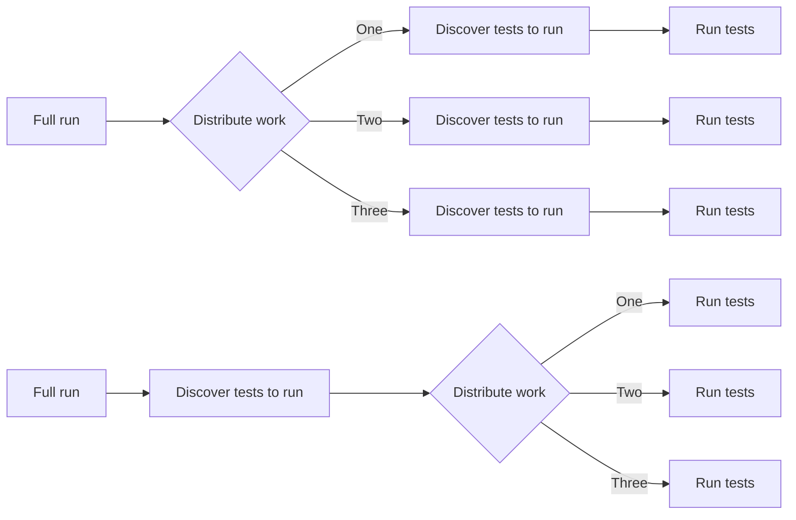

在 [UV 每月为我们赢回了 215 个计算小时](/blog/2024/04/03/build-images-with-uv/)之后，我们尝到了速度的甜头。
我们的 CI 工作流会在每次提交时触发，由于贡献量巨大，它在 2024 年 3 月被触发了 6647 次。
完整运行（即执行整个测试套件）需要很长时间。

事实证明，我们过去用来将测试拆分为 10 个组的插件效率低下。每个 pytest 任务都需要发现所有测试，即使该任务只打算执行其中的一部分。

现在我们有一个单独的任务来发现所有测试，并将它们拆分为 10 个组。这 10 个 pytest 任务只需要执行所有测试中的一部分。在每个测试运行器中不再进行完整发现，每次完整运行可为我们节省 3 个小时！

对 2024 年 3 月的 6647 个 CI 工作流进行简短分析后，得到以下统计数据：
- 2406 个在结束前被取消
    - 1771 个本应是完整运行
- 1085 个失败
    - 732 个是失败的完整运行
- 3007 个成功结束
    - 1629 个为部分运行（仅执行了给定集成（integration）的测试）
    - 1378 个为完整运行

仅考虑这 1378 次成功的完整运行，通过 [#114381](https://github.com/home-assistant/core/pull/114381)，我们在 2024 年 3 月本可节省约 **4042 小时 ~ 168 天** 的执行时间。如果我也分析了失败/被取消的那些，节省的时间还会更多。

每月节省下来的超过 168 天执行时间可以供其他任务使用，让所有开发者和我们社区的 CI 体验变得更好。
我们通过使用更少的资源来运行测试套件，提升了我们的可持续性。

**非常感谢 GitHub 为 Home Assistant 提供额外的 CI 运行器。**
