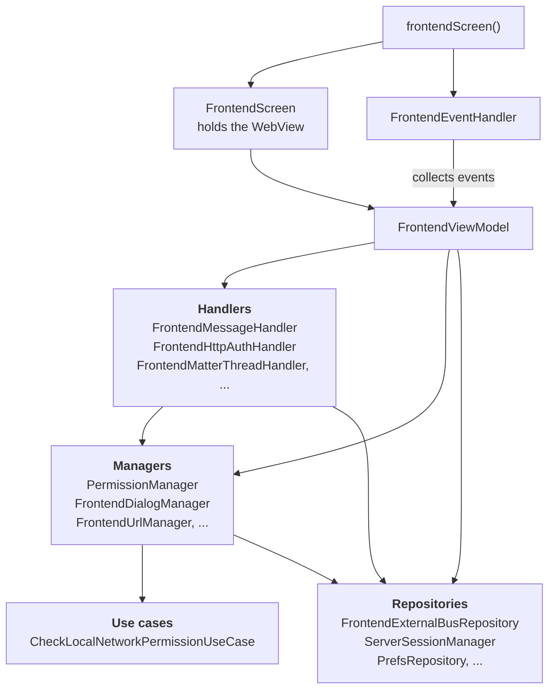
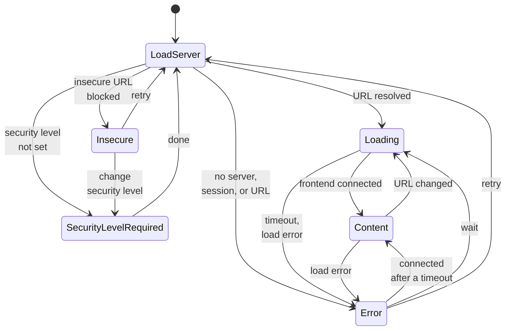
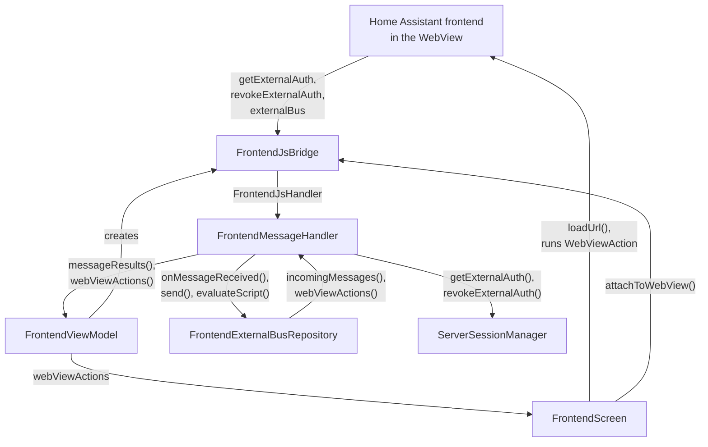

前端屏幕在一个 [WebView](https://developer.android.com/reference/android/webkit/WebView) 中显示 Home Assistant 前端，并包裹着原生功能：身份验证、手势、下载、NFC、Matter 和 Thread，以及媒体播放。它是应用中最复杂的屏幕，也是[UI 架构](/companion/android/ui-architecture/)的参考实现。它的输入同时来自四面八方：用户、Web 视图、外部总线、系统回调和超时。这正是该模式所应对的场景。代码位于 [`frontend/`](https://github.com/home-assistant/android/tree/main/app/src/main/kotlin/io/homeassistant/companion/android/frontend) 包中。较旧的 `webview/` 包是正在被移除的旧版实现。

## 组成部分

| 在模式中的角色 | 前端实现 |
| --- | --- |
| 导航和事件 | `frontendScreen()`、`FrontendEventHandler` |
| 视图 | `FrontendScreen`、`FrontendScreenContent` |
| ViewModel | `FrontendViewModel` |
| 状态 | `FrontendViewState` |
| 事件 | `FrontendEvent` |
| 操作 | `WebViewAction` |
| 提示 | `SingleSlotQueue`，配合 `FrontendDialog`、`PermissionRequest`、`FileChooserRequest` |
| 处理器 | `FrontendMessageHandler`、`FrontendMatterThreadHandler`、`FrontendHttpAuthHandler`、`FrontendFileChooserHandler` 等 |
| 管理器 | `PermissionManager`、`FrontendDialogManager`、`FrontendUrlManager`、`FrontendDownloadManager`、`FrontendGestureManager`、`FrontendExoPlayerManager` 等 |
| 仓库 | `FrontendExternalBusRepository`、`ServerSessionManager` |

它们的依赖关系遵循该模式的分层，并且只向下指向：



在运行时，结果通过各层暴露的流（flow）向上回流。管理器推送屏幕渲染的待处理状态，处理器推送 ViewModel 归约（reduce）的结果，仓库发出供处理器消费的类型化消息。

## 状态和覆盖层

`FrontendScreen` 始终在底层渲染 Web 视图，并根据状态在其上绘制一个覆盖层。Web 视图保持挂载在下方，因此当覆盖层变化时它会保留其页面。

| 状态 | 覆盖层 |
| --- | --- |
| `LoadServer`、`Loading` | 加载指示器 |
| `Content` | 无，直接显示前端 |
| `SecurityLevelRequired` | 连接安全级别设置 |
| `Insecure` | 不安全连接屏幕 |
| `Error` | 连接错误屏幕 |

`LoadServer` 是入口点。在 ViewModel 解析要加载的 URL 的同时，它还会通过加载 `about:blank` 清空 Web 视图。之后它会转入 `Loading`、`Insecure`、`SecurityLevelRequired` 或 `Error`。一旦前端通过外部总线连接，`Loading` 就会转入 `Content`。2026.8 及以后版本的服务器还会报告前端何时完成渲染，加载指示器会一直显示到那时。超时或加载错误会转入 `Error`，重试则回到 `LoadServer`。切换服务器也会重新进入 `LoadServer`。有一种错误无法重试：`FrontendConnectionError.Unrecoverable`，例如系统 WebView 启动失败。ViewModel 会忽略从该 `Error` 状态出发的任何转换。

状态之间的主要转换：



### 复用错误屏幕

连接错误屏幕与引导流程（onboarding）共用，因此它不能依赖 `FrontendViewModel`。它依赖一个只包含其所需内容的小接口 `FrontendConnectionErrorStateProvider`：

```kotlin
interface FrontendConnectionErrorStateProvider {
    val urlFlow: StateFlow<String?>
    val errorFlow: StateFlow<FrontendConnectionError?>
    val connectivityCheckState: StateFlow<ConnectivityCheckState>
    fun runConnectivityChecks()
}
```

`FrontendConnectionErrorScreen` 是针对这个接口编写的。`FrontendViewModel` 实现了它，因此错误覆盖层直接以该 ViewModel 本身作为其提供者。预览和测试使用 `FrontendConnectionErrorStateProvider.noOp`。

这就是跨屏幕复用 UI 或逻辑的通用技巧：为可复用部分所需的内容精确定义一个接口，并让每个 ViewModel 实现它。这样依赖就指向接口，而不是某个特定的 ViewModel。

## Web 视图

`FrontendScreen` 通过 `HAWebView`（一个可复用的组合项）创建 Web 视图。它在 `AndroidView` 中创建平台 `WebView`，应用基础设置，在导航宿主之前将返回按钮发送给 Web 视图历史记录，并在预览和截图测试中显示占位符。当创建 Web 视图失败时，它会报告该情况，ViewModel 会将其转换为不可恢复的 `Error` 状态。

在此基础上，`FrontendScreen` 添加了仅前端需要的内容：挂载下面提到的两个客户端，启用 Cookie（包括某些集成所依赖的第三方 Cookie），并连接下载和手势监听器。

ViewModel 创建 Web 视图的两个客户端：

- `HAWebViewClient` 来自 `HAWebViewClientFactory`。它处理 TLS 客户端证书、映射加载和 TLS 错误、报告页面加载完成、呈现 HTTP 基本认证质询，并在渲染器崩溃时恢复。
- `HAWebChromeClient` 来自 `viewModel.createWebChromeClient()`。它处理摄像头和麦克风权限请求、JavaScript `confirm()` 对话框、文件选择器和全屏视频。

> [!NOTE]
> ViewModel 通常不持有平台 UI 类型。这两个客户端是唯一被接受的例外，因为它们与 ViewModel 逻辑绑定：错误映射、页面加载回调、HTTP 认证和权限。这不会损害可测试性：Web 视图客户端来自一个测试可以伪造（fake）的工厂，而 chrome 客户端只在屏幕请求时才构建。ViewModel 的归约逻辑仍然可以作为普通的 JVM 单元测试运行。

## 与前端通信

前端和应用通过一个 JavaScript 桥接进行通信。它承载两件事：

- **外部身份验证**：前端向应用请求访问令牌（access token），而不是显示登录页面。
- **外部总线**：双向消息，例如打开原生设置、扫描二维码或启动 Assist。

前端一侧的文档见[外部身份验证](/frontend/reference/external-auth/)和[外部总线](/frontend/reference/external-bus/)。

`FrontendJsBridge` 是注册在 Web 视图中的 JavaScript 接口。它将来自前端的调用解析为类型化消息，并交给 `FrontendMessageHandler`。`FrontendExternalBusRepository` 拥有总线本身：它反序列化传入的 JSON（容忍它不认识的消息类型），并将传出消息转换为脚本。

`FrontendScreen` 之下的任何内容都不直接接触 Web 视图。其他一切都通过流进行通信：



用文字描述：

- **前端到应用**：前端调用桥接，处理器将消息传递给仓库，结果作为类型化事件流回 ViewModel。
- **应用到前端**：某个组件向仓库发送一条类型化消息，仓库将其包装在 `WebViewAction.EvaluateScript` 中。`FrontendScreen` 在 Web 视图中执行它。
- **身份验证**：前端调用 `getExternalAuth` 或 `revokeExternalAuth`，处理器询问 `ServerSessionManager`，回调脚本在 Web 视图中运行。桥接在传递调用之前会检查回调名称。

操作和事件流是带有小额外缓冲区的 `SharedFlow`，因此当 Web 视图仍在处理较早的命令时，发送方不必等待。但它们不会重放：在没有任何收集者收集流时发送的命令会被丢弃。

### 两个桥接版本

桥接存在两个版本：

- **V1**（`window.externalApp`）使用 `addJavascriptInterface`。前端直接调用命名方法。
- **V2**（`window.externalAppV2`）使用 `WebViewCompat.addWebMessageListener`，适用于 Home Assistant 2026.4.2 及更高版本。所有消息都通过 `postMessage` 以带有 `type` 的 JSON 形式传输，并出于安全考虑对来源（origin）和框架（frame）进行过滤。

当服务器足够新且设备的 WebView 支持 `WEB_MESSAGE_LISTENER` 特性时，应用使用 V2。否则，它会回退到 V1。

## 作用域

一次屏幕会话中的各个块都是 `@ViewModelScoped` 的。这包括 `FrontendExternalBusRepository`：总线只为一个 Web 视图存在，因此一次访问中缓冲的消息不会泄漏到下一次。`FrontendHandlerModule` 在 `ViewModelComponent` 中将 `FrontendMessageHandler` 同时绑定为 `FrontendJsHandler` 和 `FrontendBusObserver`，因此两个角色共享同一个实例。

## 测试

| 内容 | 测试类型 |
| --- | --- |
| `FrontendViewModel` | 使用 JUnit 和 Turbine 的单元测试 |
| 管理器和处理器 | 单元测试，每次关注一个问题 |
| `FrontendScreenContent` | Compose UI 测试，按状态进行 |
| `FrontendEventHandler` | Compose UI 测试，每个事件一个 |
| `FrontendScreen` | 截图测试，仅针对外观，不含逻辑 |
