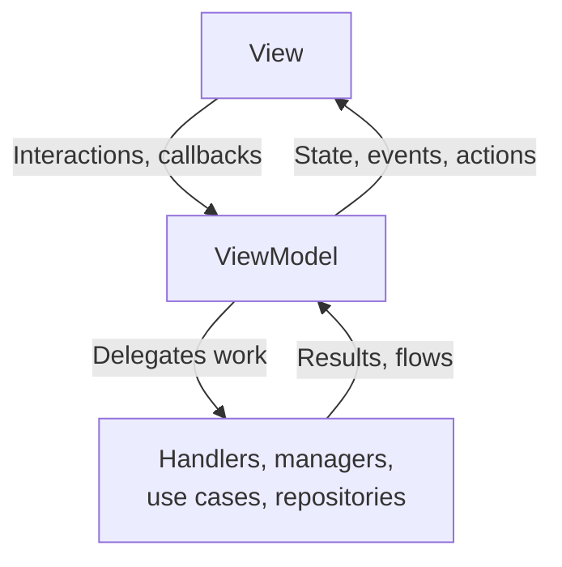
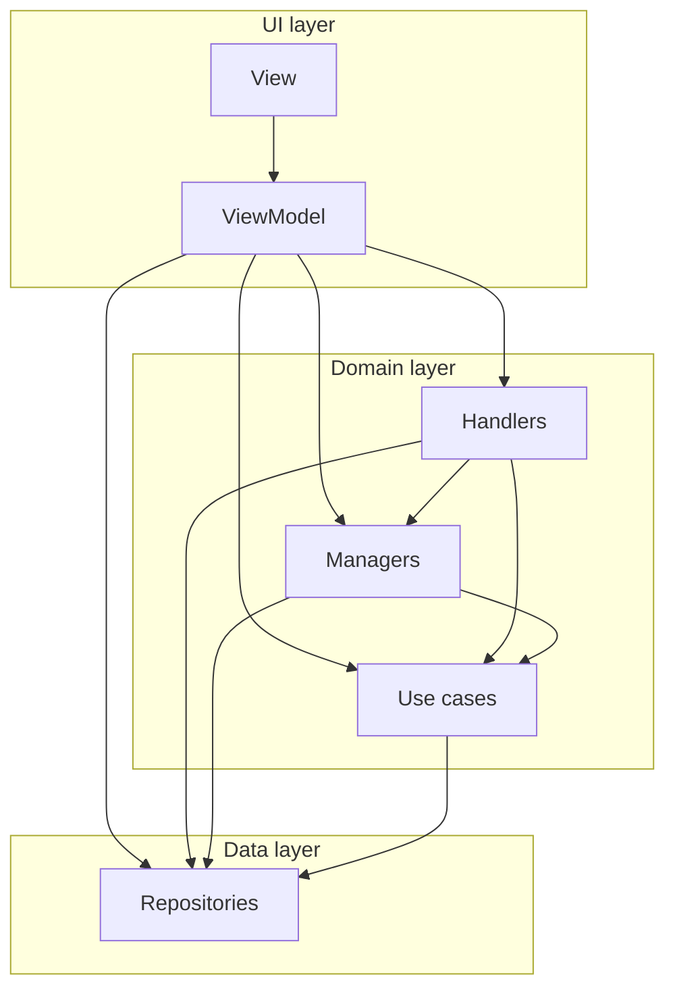

每个新屏幕都遵循相同的模式。这是对 Google [推荐应用架构](https://developer.android.com/topic/architecture) 的一种类 MVI 的实现：同样的 UI、领域和数据层，并对输入和输出的流动方式制定了严格的契约。现有屏幕会逐步迁移到该模式。[前端屏幕](/companion/android/frontend-screen/) 是参考实现。

## 为什么采用这种模式

一个屏幕同时有许多输入：用户、系统回调（如权限结果）、定时器和外部消息。该模式将它们全部简化为少数几个定义明确的输出，因此屏幕保持可预测且易于测试。

它还能让屏幕保持小巧。没有结构的话，屏幕会成长为一个无所不知、无法安全测试或修改的 ViewModel。在这里，每个关注点都位于自己的小模块中，只做一件事。

## 数据流

输入向下进入 ViewModel。ViewModel 将工作委托给其下方的模块，并将它们的结果简化为最多三种输出，向上流回视图。数据只沿一个方向流动：



三种输出：

| 输出 | 是什么 | 示例 |
| --- | --- | --- |
| 状态（State） | 要渲染的内容。单一值，始终为最新 | 服务器列表、加载标志 |
| 事件（Event） | 必须恰好发生一次的一次性效果 | 返回上一页、显示 snackbar |
| 动作（Action） | 针对仅由视图持有的对象的命令 | 重新加载 web view、滚动到顶部 |

大多数输入只会产生一个新状态。大多数屏幕从不需要动作。

## 视图

视图是 Compose 屏幕。它渲染状态、通过回调报告交互，并持有任何下层不得触碰的 UI 句柄，例如 `WebView` 或 `LazyListState`。

将每个屏幕拆分为一个有状态的入口点和一个无状态的内容 composable。这样预览、截图测试和 Compose 测试就可以直接驱动内容：

```kotlin
@Composable
internal fun SettingsScreen(viewModel: SettingsViewModel) {
    val viewState by viewModel.viewState.collectAsStateWithLifecycle()

    SettingsScreenContent(
        viewState = viewState,
        onNameChange = viewModel::onNameChange,
    )
}

@Composable
internal fun SettingsScreenContent(
    viewState: SettingsViewState,
    onNameChange: (String) -> Unit,
) {
    // Renders viewState, reports interactions through the callbacks
}
```

## ViewModel

ViewModel 持有这些输出，并将各模块连接起来：

```kotlin
val viewState: StateFlow<UiState> // what to render
val events: SharedFlow<UiEvent>   // one-shot effects
val actions: Flow<UiAction>       // only if the view owns a handle
```

规则：

- 它绝不引用 Compose 或平台 UI 类型，因此其逻辑可以作为普通的 JVM 单元测试运行。
- 它的生命周期长于配置变更。`viewModelScope` 只在屏幕永久消失时才会被取消，因此屏幕旋转不会重启加载或流收集。
- 保持精简。小屏幕可以将其逻辑保留在 ViewModel 中。当它变大时，将内聚的逻辑移到下方的[模块](#the-blocks)中。

### 状态

状态是屏幕上所显示内容的唯一事实来源。

- **不可变。** 使用 `val` 和不可变集合，并通过 `copy()` 进行修改。原地修改会破坏 Compose 的变更检测。
- **结构相等。** 使用 data class。`StateFlow` 会跳过与当前值相等的值，因此再次发出相同的状态没有任何开销。
- **读取开销低。** Compose 在主线程上、每次重组时都会读取状态。绝不要在 getter 中计算。在构建状态时、在后台调度器上计算：

```kotlin
// Bad: maps the list on every recomposition, on the main thread
data class UiState(val servers: List<Server>) {
    val serverItems: List<HADropdownItem<Int>>
        get() = servers.map { HADropdownItem(it.id, it.friendlyName) }
}

// Good: mapped once, when the state is created
data class UiState(val serverItems: List<HADropdownItem<Int>>)
```

根据屏幕来设计状态的结构。当屏幕外观始终一致时，一个 data class 就够了。当屏幕有明显的不同模式时，使用密封层次结构（sealed hierarchy），这样编译器会强制你处理每种模式，且一种模式的字段不会泄漏到另一种模式中：

```kotlin
sealed interface UiState {
    data object Loading : UiState
    data class Content(val items: List<Item>) : UiState
    data class Error(val error: ErrorReason) : UiState
}
```

### 事件

事件是“发出即忘”的：导航、显示 snackbar、打开链接。将它们建模为密封接口（sealed interface），这样处理器的 `when` 就是穷尽的：

```kotlin
sealed interface UiEvent {
    data object NavigateBack : UiEvent
    data class ShowSnackbar(@StringRes val messageResId: Int) : UiEvent
}
```

在 `Flow` 上发出它们，并且每个事件只消费一次，通常在导航层中。绝不要重放事件：重组后重放“返回上一页”会导致导航两次。如果 UI 在旋转后必须再次显示某些内容，那它是状态，而不是事件。

### 动作

有些对象必须存在于视图中，因为它们由 Compose 创建：`WebView`、`LazyListState`、焦点请求器。ViewModel 无法持有它们。然而对它们的一些操作是命令式的，比如“立即重新加载”。

对于这些情况，ViewModel 发出一个带类型的动作，视图对它持有的对象执行该动作。每个动作都带有自己的 `run`：

```kotlin
sealed interface WebViewAction {
    fun run(webView: WebView)

    data object Reload : WebViewAction {
        override fun run(webView: WebView) = webView.reload()
    }
}

// In the view, the only place that holds the WebView
LaunchedEffect(webView) {
    webViewActions.collect { action -> action.run(webView) }
}
```

该流是一个带缓冲的 `SharedFlow`，只消费一次，因此当视图短暂消失时命令不会丢失。需要返回结果的动作可以携带一个 `CompletableDeferred`。

动作不是状态：作为状态持有的命令会在每次重组时再次执行。它也不是事件：事件是宿主做出反应的信号，比如导航，而动作驱动的是该屏幕拥有的某一个对象。

只对必须存在于视图中的对象使用动作。例如，媒体播放器可以存在于管理器中并作为状态暴露。实际上，一个屏幕最多只有一个这样的对象，通常一个都没有。

### 选择输出

问自己这个输出是什么，而不是它来自哪里：

| 如果该输出 | 使用 | 原因 |
| --- | --- | --- |
| 决定渲染的内容，并且必须在重组和旋转后保留 | 状态 | 再次发出相同的值是无操作 |
| 是必须恰好发生一次的副作用 | 事件 | 重放它会导致导航两次或显示两次 snackbar |
| 是针对视图持有的对象的命令 | 动作 | ViewModel 保持不含 UI 类型 |
| 向用户提问并等待回答 | 管理器中的提示 | 一次只显示一个提示，调用方挂起直到用户回答 |

## 模块

ViewModel 将功能逻辑委托给四种模块。按其类型为每个类命名：`*Repository`、`*UseCase`、`*Manager`、`*Handler`。

| 模块 | 是什么 | 可以依赖 |
| --- | --- | --- |
| 仓库（Repository） | 单一数据源或通道的唯一事实来源：存储、网络、Room DAO、外部总线 | 仅数据源，绝不能是另一个仓库 |
| 用例（Use case） | 一个无状态、可复用的操作，以 `operator fun invoke()` 形式暴露 | 仓库 |
| 管理器（Manager） | 一个功能关注点的逻辑和内存中的状态 | 仓库、用例、平台 API。绝不能是另一个管理器 |
| 处理器（Handler） | 协调一个或多个管理器的逻辑 | 管理器、用例、仓库。绝不能是另一个处理器 |

管理器和处理器之间的区别只在于一个问题：它是否依赖某个管理器？如果是，它就是处理器。无论它是否持有状态、是转换单个输入还是驱动多步流程，都无关紧要：处理器可以是其中任何一种。这条规则从定义上使管理器之间的依赖成为不可能。

处理器将其工作以密封结果（sealed result）或结果流的形式返回给 ViewModel。它可以为自身的功能保留状态，ViewModel 会将其映射到屏幕状态中。屏幕的状态始终属于 ViewModel。

管理器以三种方式与屏幕通信：它将待处理状态暴露为视图渲染的 `StateFlow`，它从 `suspend` 函数返回密封结果，或者它暴露一个结果的 `Flow`。

管理器也是提示（prompt）所在之处：等待用户回答的对话框、权限请求或文件选择器。对它们使用 `SingleSlotQueue`。它一次只显示一个提示，将当前请求暴露为状态，并让调用方 `awaitResult` 直到用户回答。提示不是第四种输出：它是视图渲染的待处理状态，回答作为普通输入返回。

当逻辑被多个调用方需要，或者会使 ViewModel 或管理器臃肿，但自身没有状态时，就使用用例。例如 `CheckLocalNetworkPermissionUseCase` 和 `ServerChooserItemsUseCase`。

数据库访问也要通过仓库：Room DAO 是数据源，而仓库是应用其余部分所看到的东西。组合多个数据源属于逻辑，因此它属于用例、管理器或处理器，而不是仓库。

### 选择模块

自上而下地判断。第一个符合的行胜出：

| 你有 | 使用 |
| --- | --- |
| 对数据源或通信通道的访问 | 仓库 |
| 一个无状态的可复用操作 | 用例 |
| 一个拥有自己状态的功能关注点 | 管理器 |
| 协调管理器的逻辑 | 处理器 |
| 屏幕级的状态和协调 | ViewModel |

## 层次与依赖

视图和 ViewModel 属于 UI 层。处理器、管理器和用例属于领域层。仓库属于数据层。依赖只向下指向：

- ViewModel 可以直接使用任何模块。
- 处理器使用管理器、用例和仓库。
- 管理器使用用例和仓库。
- 用例使用仓库。
- 没有处理器使用另一个处理器。在 ViewModel 中协调处理器。
- 只有当协调管理器会使 ViewModel 臃肿时，ViewModel 才提取出一个处理器。

以图的形式表示同样的规则，每条箭头都向下指向：



没有任何东西向上或横向指向。这使图保持无环，并且每个模块都可以独立测试。

## 作用域

根据状态需要存活的时间来为模块设定作用域：

- 属于单个屏幕的模块使用 `@ViewModelScoped`。该屏幕会话中的所有内容共享一个实例，会话结束时它会重置。
- 代表应用级关注点的模块通常使用 `@Singleton`。

共享实例很重要。如果 ViewModel 和一个处理器都注入了一个有状态的管理器，它们必须得到同一个对象，否则它们对状态的视图会逐渐偏离。未设定作用域的绑定会给每个消费者一个自己的副本。这就是有状态与否重要的地方：有状态的模块需要一个与其状态存活时间相匹配的作用域。

通过 Hilt 提供一切。绝不要手动创建这些模块。

## 测试

这种拆分正是屏幕可测试的原因：

| 层 | 测试类型 | 检查什么 |
| --- | --- | --- |
| ViewModel | 单元测试 | 哪个输入产生哪个状态、事件或动作 |
| 处理器、管理器、用例 | 单元测试 | 每个关注点独立测试 |
| 无状态内容 | Compose UI | 每种状态下的渲染，以及交互是否调用了正确的回调 |
| 事件处理 | Compose UI | 每个事件触发正确的导航或效果 |
| 屏幕 | 截图测试 | 仅外观，不含逻辑 |

参见[测试](/companion/android/testing/)和[截图测试](/companion/android/screenshot-testing/)。
