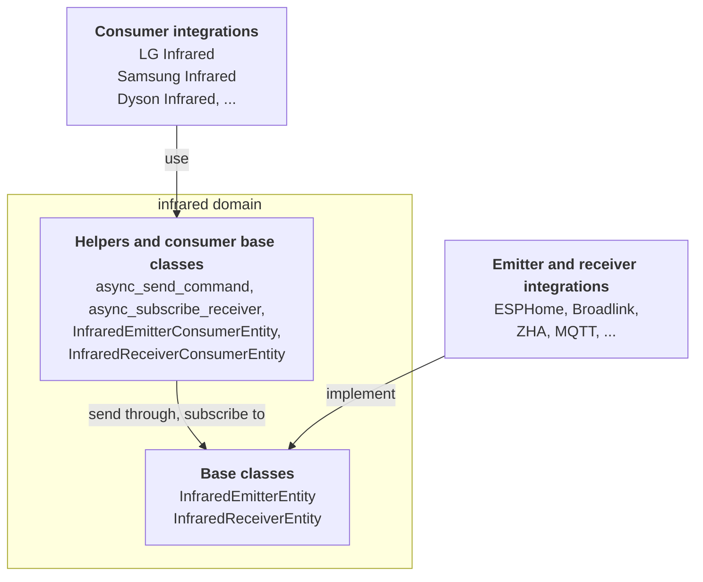

红外（infrared）域将红外控制一分为二。一些集成（integration）拥有硬件：例如带有红外 LED 或红外接收器的 ESPHome 开发板或 Broadlink 集线器。另一些集成则了解设备（device）：哪些代码可以打开 Dyson 风扇，或切换 Edifier 音箱的输入源。有了红外域作为中间层，设备集成可以搭配任何红外硬件工作，而硬件集成也无须了解任何具体设备。

共有三种角色：

- **发射器（emitter）集成** 拥有发送红外信号的硬件。它们提供基于 `InfraredEmitterEntity` 的实体。
- **接收器（receiver）集成** 拥有接收红外信号的硬件。它们提供基于 `InfraredReceiverEntity` 的实体。
- **消费者（consumer）集成** 了解设备及其代码。它们不创建红外实体，而是创建常规实体，例如[按钮](/core/entities/button/)、[风扇](/core/entities/fan/)或[媒体播放器](/core/entities/media-player/)，并通过用户（通常在配置流程中）选择的发射器或接收器进行发送或接收。

各角色如何通过红外域连接：



所有内容都位于 `homeassistant.components.infrared` 中。命令本身来自 [`infrared-protocols`](https://github.com/home-assistant-libs/infrared-protocols) 库。对于射频信号的相同模式，请参见[射频实体](/core/entities/radio-frequency/)。

## 属性

红外实体没有需要实现的自身属性。每个实体都具有的通用属性请参见[实体类](/core/entities/entity-class/)。

基类会为你设置一些内容：

| 名称 | 值 | 描述 |
| --- | --- | --- |
| `device_class` | `InfraredDeviceClass.EMITTER` 或 `InfraredDeviceClass.RECEIVER` | 由基类设置。没有名称的实体将根据其设备类别命名。 |
| `should_poll` | `False` | 红外实体从不轮询。 |
| `state` | 最终值 | 最后一次发送命令或接收信号的时间。请参见[状态](#states)。 |

两个基类都继承自 `RestoreEntity`，因此最后一次的时间戳能够在重启后保留。

## 支持的功能

红外实体没有支持的功能。一个实体要么是发射器，要么是接收器。如果你的硬件两者都能做，请分别创建一个实体。

## 发射器

实现 `async_send_command`。它接收一个 `InfraredCommand`（`infrared-protocols` 的 `Command` 基类，由红外域重新导出），并且必须将其发送出去，失败时抛出 `HomeAssistantError`。所需的一切都在命令上：`modulation` 是以赫兹为单位的载波频率，`get_raw_timings()` 返回以微秒为单位的时序（正值表示脉冲，负值表示间隔）。

```python
class MyInfraredEmitter(InfraredEmitterEntity):
    async def async_send_command(self, command: InfraredCommand) -> None:
        """Send an IR command."""
```

不要从其他代码中调用此方法。消费者通过 `async_send_command` 辅助函数进行操作，该函数会验证实体、传递上下文，并在发送成功后更新状态。

## 接收器

接收器没有需要实现的方法。当你的硬件接收到信号时，请使用 `_handle_received_signal` 将其交给基类。基类会更新状态并调用每个订阅者。

```python
class MyInfraredReceiver(InfraredReceiverEntity):
    @callback
    def _on_hardware_signal(self, timings: list[int]) -> None:
        """Pass a signal from the hardware on to subscribers."""
        self._handle_received_signal(InfraredReceivedSignal(timings=timings))
```

`InfraredReceivedSignal` 包含 `timings`（一个 `int` 列表）和可选的 `modulation`。请从事件循环中调用 `_handle_received_signal`。

## 消费者辅助函数

消费者从不持有红外实体的引用。它们通过实体 ID（或注册表 ID）以及以下辅助函数进行操作：

| 辅助函数 | 描述 |
| --- | --- |
| `async_get_emitters(hass)` | 所有发射器实体的实体 ID。可用它在配置流程中提供选择。 |
| `async_get_receivers(hass)` | 所有接收器实体的实体 ID。 |
| `async_send_command(hass, entity_id_or_uuid, command, context=None)` | 通过发射器发送命令。当红外域未加载或发射器不存在时抛出 `HomeAssistantError`。 |
| `async_subscribe_receiver(hass, entity_id_or_uuid, signal_callback)` | 每收到一个信号，就以 `InfraredReceivedSignal` 调用 `signal_callback`。返回用于取消订阅的回调。当红外域未加载或接收器不存在时抛出 `HomeAssistantError`。 |

大多数消费者不需要直接使用这些辅助函数，因为有两个基类会替它们完成工作：

- `InfraredEmitterConsumerEntity`：设置 `_infrared_emitter_entity_id`，然后调用 `await self._send_command(command)`。只有在发射器可用时该实体才可用，并且操作的上下文会被传递下去。
- `InfraredReceiverConsumerEntity`：设置 `_infrared_receiver_entity_id` 并实现 `_handle_signal(signal)` 回调。基类会在接收器可用期间进行订阅，并在接收器消失或实体被移除时取消订阅。

将它们混入（mixin）到你平台的实体类之前，例如 `class MyButton(InfraredEmitterConsumerEntity, ButtonEntity)`。当你重写 `_async_infrared_availability_changed` 以响应可用性变化时，请先调用 `super()`。

> [!NOTE]
> `InfraredEntity` 和 `InfraredEntityDescription` 是发射器类的已弃用别名，将在 Home Assistant 2027.6 中停止工作。请使用 `InfraredEmitterEntity` 和 `InfraredEmitterEntityDescription`。

## 方法

| 角色 | 方法 | 描述 |
| --- | --- | --- |
| 发射器 | `async_send_command(command)` | 必需。将命令发送到硬件。没有同步版本。 |
| 接收器 | 无 | 当信号到达时调用 `_handle_received_signal(signal)`。 |
| 接收器消费者 | `_handle_signal(signal)` | 必需。处理接收到的信号的回调。 |

## 状态

发射器的状态是最后一次发送命令的时间。接收器的状态是最后一次接收信号的时间。两者都是带毫秒的 ISO 8601 时间戳，例如 `2026-10-10T08:15:00.123+00:00`，在第一次之前则为 `unknown`。状态是最终值：由基类进行管理。

## 示例

一个消费者按钮，通过用户在配置流程中选择的发射器打开电视。

```python
from infrared_protocols.commands.nec import NECCommand

from homeassistant.components.button import ButtonEntity
from homeassistant.components.infrared import InfraredEmitterConsumerEntity

POWER_ON = NECCommand(address=0x04, command=0x08)


class MyTvPowerButton(InfraredEmitterConsumerEntity, ButtonEntity):
    """Turn on the TV over infrared."""

    _attr_has_entity_name = True
    _attr_translation_key = "power_on"

    def __init__(self, entry_id: str, emitter_entity_id: str) -> None:
        """Initialize the button."""
        self._attr_unique_id = f"{entry_id}_power_on"
        self._infrared_emitter_entity_id = emitter_entity_id

    async def async_press(self) -> None:
        """Send the power on code."""
        await self._send_command(POWER_ON)
```
