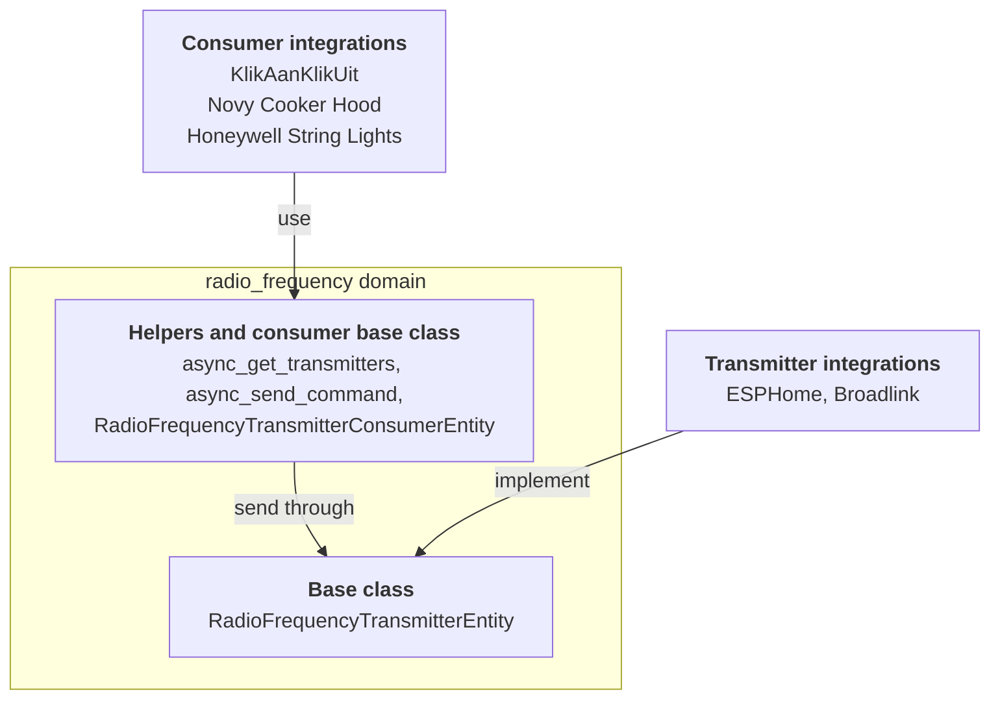

射频（radio frequency）域位于射频硬件与其控制的设备之间。许多廉价设备会监听 433 MHz 或 868 MHz 上的简单无线电编码：车库门、无线插座、灯串、抽油烟机。一个集成拥有无线电，例如 ESPHome 板或 Broadlink 网关。另一个集成则了解某个设备及其监听的编码。射频域让它们无需彼此了解即可协同工作。

有两种角色：

- **发射器集成（transmitter integrations）**拥有发送射频信号的硬件。它们提供基于 `RadioFrequencyTransmitterEntity` 的实体（entity）。
- **消费方集成（consumer integrations）**了解某个设备及其编码。它们不创建射频实体，而是创建常规实体，例如[开关（switch）](/core/entities/switch/)或[灯（light）](/core/entities/light/)，并通过用户选择的发射器发送，通常是在配置流程（config flow）中选择。

各角色如何通过射频域进行连接：



所有内容都位于 `homeassistant.components.radio_frequency` 中。命令来自 [`rf-protocols`](https://github.com/home-assistant-libs/rf-protocols) 库，该域重新导出了其中的 `RadioFrequencyCommand` 和 `ModulationType`。与[红外实体（infrared entity）](/core/entities/infrared/)不同，这里没有接收方角色：射频实体只负责发送。

## 属性

这些属性是射频实体特有的。每个实体都具有的通用属性请参见[实体类（entity class）](/core/entities/entity-class/)。

| 名称 | 类型 | 默认值 | 描述 |
| --- | --- | --- | --- |
| `supported_frequency_ranges` | `list[tuple[int, int]]` | 必需 | 硬件可以发送的频率范围，以 `(min_hz, max_hz)` 元组表示。它是一个抽象的 property：请将其实现为 property，而不要实现为 `_attr_` 属性。 |

基类将 `should_poll` 设置为 `False` 并管理状态。它扩展了 `RestoreEntity`，因此最后一次命令的时间能够在重启后保留。

## 支持的功能

射频实体没有支持的功能。发射器能够做什么由其频率范围和调制方式描述。目前，唯一的调制方式是 `ModulationType.OOK`（通断键控，on-off keying），并且假定每个发射器都支持它。

## 发射器

发射器需要实现两件事：频率范围，以及发送命令。

`async_send_command` 接收一个 `RadioFrequencyCommand`。从中读取你需要的内容：以赫兹为单位的 `frequency`、`modulation`、`repeat_count`、可选的 `symbol_rate` 和 `output_power`，以及 `get_raw_timings()`，它以微秒为单位将信号返回为交替的脉冲（正值）和间隔（负值）。发送失败时抛出 `HomeAssistantError`。

不要从其他代码中调用实体上的 `async_send_command`。消费方应通过 `async_send_command` 辅助函数，它会检查频率和调制方式、传递上下文，并在成功发送后更新状态。

## 消费方辅助函数

消费方从不持有对发射器实体的引用。它们使用实体 ID（或其注册表 ID）以及这些辅助函数：

| 辅助函数 | 描述 |
| --- | --- |
| `async_get_transmitters(hass, frequency, modulation)` | 支持该频率和调制方式的所有发射器的实体 ID。空列表表示没有发射器符合条件。当该域未加载或完全没有任何发射器时，抛出 `HomeAssistantError`。 |
| `async_send_command(hass, entity_id_or_uuid, command, context=None)` | 通过发射器发送命令。当该域未加载、发射器不存在，或发射器不支持该命令的频率或调制方式时，抛出 `HomeAssistantError`。 |

`RadioFrequencyTransmitterConsumerEntity` 基类会为你完成相关的簿记工作。将 `_rf_transmitter_entity_id` 设置为发射器的实体 ID，然后调用 `await self._send_command(command)`。基类会让你的实体仅在发射器可用时才保持可用，并传递该操作的上下文。将其作为混入（mixin）放在你的平台实体类之前。

对于配置流程和前端，还有一个 `radio_frequency/list` WebSocket 命令（仅限管理员）。它列出每个发射器及其设备、配置条目（config entry）、频率范围和支持的调制方式。

## 方法

| 方法 | 描述 |
| --- | --- |
| `async_send_command(command)` | 必需。以无线方式发送该命令。没有同步版本。 |
| `supported_frequency_ranges` | 必需的 property。返回 `(min_hz, max_hz)` 范围。 |

`supports_frequency` 和 `supports_modulation` 是 final 的：基类根据频率范围和调制方式来实现它们。

## 状态

状态为最后一次发送命令的时间，是一个带毫秒的 ISO 8601 时间戳，例如 `2026-10-10T08:15:00.123+00:00`，在发送第一条命令之前则为 `unknown`。它是 final 的：由基类进行管理。

## 示例

网络集线器上一个 433 MHz 无线电的发射器。

```python
from homeassistant.components.radio_frequency import (
    RadioFrequencyCommand,
    RadioFrequencyTransmitterEntity,
)
from homeassistant.exceptions import HomeAssistantError


class MyRfTransmitter(RadioFrequencyTransmitterEntity):
    """The 433 MHz radio of a hub."""

    _attr_has_entity_name = True
    _attr_translation_key = "rf_transmitter"

    def __init__(self, hub: MyHub) -> None:
        """Initialize the transmitter."""
        self._hub = hub
        self._attr_unique_id = f"{hub.serial}_rf"

    @property
    def supported_frequency_ranges(self) -> list[tuple[int, int]]:
        """Return the bands this radio can transmit on."""
        return [(433_050_000, 434_790_000)]

    async def async_send_command(
        self, command: RadioFrequencyCommand
    ) -> None:
        """Send the command."""
        try:
            await self._hub.send_rf(
                frequency=command.frequency,
                timings=command.get_raw_timings(),
                repeat=command.repeat_count,
            )
        except MyHubError as err:
            raise HomeAssistantError(f"Sending failed: {err}") from err
```

在消费方一侧，无线插座的开关只需在 `RadioFrequencyTransmitterConsumerEntity` 之上再写几行代码：

```python
from typing import Any

from rf_protocols.commands.kaku import KakuCommand

from homeassistant.components.radio_frequency import (
    RadioFrequencyTransmitterConsumerEntity,
)
from homeassistant.components.switch import SwitchEntity


class MySocket(RadioFrequencyTransmitterConsumerEntity, SwitchEntity):
    """A wireless socket that listens to KlikAanKlikUit codes."""

    _attr_has_entity_name = True
    _attr_name = None
    _attr_assumed_state = True

    def __init__(
        self, entry_id: str, transmitter: str, code: int, channel: int
    ) -> None:
        """Initialize the socket."""
        self._attr_unique_id = entry_id
        self._rf_transmitter_entity_id = transmitter
        self._code = code
        self._channel = channel

    async def async_turn_on(self, **kwargs: Any) -> None:
        """Send the on code."""
        await self._send_command(
            KakuCommand(
                id=self._code, group=False, channel=self._channel, on=True
            )
        )
        self._attr_is_on = True
        self.async_write_ha_state()

    async def async_turn_off(self, **kwargs: Any) -> None:
        """Send the off code."""
        await self._send_command(
            KakuCommand(
                id=self._code, group=False, channel=self._channel, on=False
            )
        )
        self._attr_is_on = False
        self.async_write_ha_state()
```
