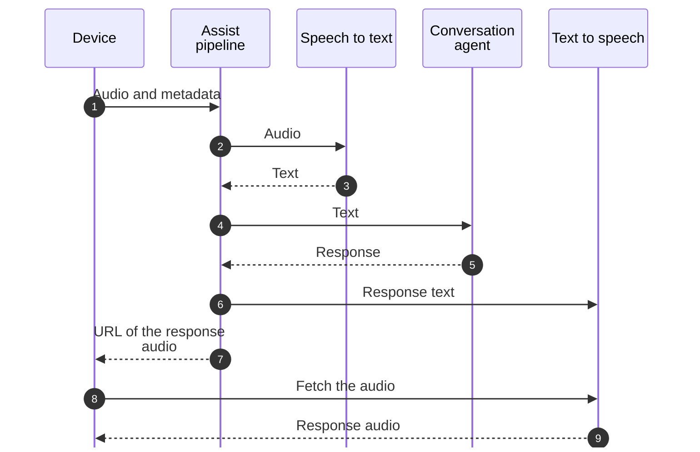
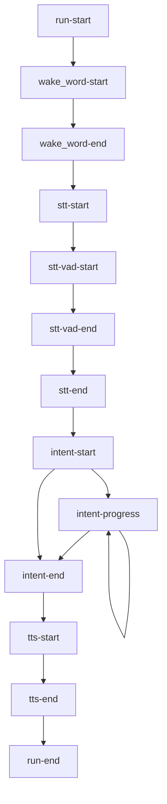

Home Assistant 中的语音由一连串各司其职的小部件组成。[Assist 管道（Assist pipeline）](/glossary/assist-pipeline/)将它们串联在一起。语音卫星设备（voice satellite），比如智能音箱，只需采集音频并播放回答：其余工作都由 Home Assistant 完成。

## 语音在 Home Assistant 中的流转方式

1. 设备向管道流式传输音频，并附带采样率等元数据。
2. **唤醒词检测（wake word detection）**监听唤醒词，比如"Okay Nabu"。可选：许多设备会自行检测唤醒词。
3. **语音转文本（speech to text）**将口头命令转换为文本。
4. **意图识别（intent recognition）**将该文本交给[对话代理（conversation agent）](/glossary/conversation-agent/)。内置代理会将其匹配到一个[意图（intent）](/core/internals/intents/)，处理该意图并返回响应。由语言模型支持的代理则以自己的方式完成这一过程。
5. **文本转语音（text to speech）**将响应转换为音频。
6. 设备播放音频。

对于自行检测唤醒词的设备，同样的流程按步骤如下：



每个部分都是一个独立的集成（integration），并且有集成提供的相应实体（entity）类型：

- `assist_pipeline` 运行管道。
- `wake_word` 检测唤醒词。提供者（provider）是[唤醒词实体（wake word entity）](/core/entities/wake-word/)。
- `stt` 将语音转换为文本。提供者是[语音转文本实体（speech-to-text entity）](/core/entities/stt/)。
- `conversation` 处理文本。代理是[对话实体（conversation entity）](/core/entities/conversation/)。
- `tts` 将文本转换为语音。提供者是[文本转语音实体（text-to-speech entity）](/core/entities/tts/)。

用户在**设置** > **语音助手**下设置管道，为每个步骤选择语言和提供者。作为语音卫星的设备是一个 [Assist 卫星实体（Assist satellite entity）](/core/entities/assist-satellite/)，它会为您运行管道。

## 运行管道

不是 Assist 卫星实体的客户端（比如应用或自定义设备），可以通过 WebSocket API 使用 `assist_pipeline/run` 运行管道：

```json
{
  "id": 7,
  "type": "assist_pipeline/run",
  "start_stage": "stt",
  "end_stage": "tts",
  "input": {
    "sample_rate": 16000
  }
}
```

[websocket-voice-assistant](https://github.com/OHF-Voice/websocket-voice-assistant) 项目是一个完整的示例客户端。

| 字段 | 描述 |
| --- | --- |
| `start_stage` | 必填。要运行的第一个阶段：`wake_word`、`stt`、`intent` 或 `tts`。 |
| `end_stage` | 必填。要运行的最后一个阶段：`stt`、`intent` 或 `tts`。 |
| `input` | 取决于起始阶段。见下文。 |
| `pipeline` | 要运行的管道 ID。默认为首选管道。`assist_pipeline/pipeline/list` 可列出所有管道。 |
| `conversation_id` | 继续之前的对话。参见[对话 API](/core/internals/conversation-api/#conversations)。 |
| `device_id` | 启动管道的设备（来自设备注册表）。 |
| `timeout` | 整个运行超时前的秒数。默认为 300。 |

`input` 中包含的内容：

- 从 `wake_word` 开始：`sample_rate`（必填）、`timeout`（放弃前的静音秒数，默认为 3），以及[音频增强](#audio-enhancements)。
- 从 `stt` 开始：`sample_rate`（必填），以及可选的 `wake_word_phrase`，即在设备上检测到的唤醒词。Home Assistant 用它来避免多个设备响应同一个唤醒词。
- 从 `intent` 或 `tts` 开始：`text`。

## 事件

在运行过程中，管道会通过连接发送 `event` 消息，并附带运行命令的 `id`。每个事件都有一个 `type` 和 `data`：

| 事件 | 时机 | 数据 |
| --- | --- | --- |
| `run-start` | 始终 | `pipeline`、`language`、`conversation_id`、包含 `stt_binary_handler_id` 和 `timeout` 的 `runner_data`，以及 `tts_output`（包含即将到来的响应音频的 `url` 和 `token`、音频的 `mime_type`，以及 `stream_response`）。 |
| `wake_word-start` | 仅音频 | `engine`、音频 `metadata`，以及 `timeout`。 |
| `wake_word-end` | 仅音频 | `wake_word_output`（包含 `wake_word_id`），以及从音频开始算起的毫秒级 `timestamp`。 |
| `stt-start` | 仅音频 | `engine` 和音频 `metadata`。 |
| `stt-vad-start` | 仅音频 | `timestamp`，语音命令开始的时间，以从音频开始算起的毫秒数表示。 |
| `stt-vad-end` | 仅音频 | `timestamp`，语音命令结束的时间。 |
| `stt-end` | 仅音频 | `stt_output`（包含识别出的 `text`）。 |
| `intent-start` | 始终 | `engine`（代理）、`language`，以及 `intent_input`（文本）。 |
| `intent-progress` | 部分代理 | `chat_log_delta`（代理流式传输响应时包含其中的一部分），或在回答完成前文本转语音开始时的 `tts_start_streaming`。 |
| `intent-end` | 始终 | `intent_output`（一个[对话响应（conversation response）](/core/internals/conversation-api/#the-response)），以及 `processed_locally`。 |
| `tts-start` | 仅音频 | `engine`、`language`、`voice`，以及 `tts_input`（要朗读的文本）。 |
| `tts-end` | 仅音频 | `tts_output`（包含音频的 `url`、`token`、`mime_type` 和 `media_id`）。 |
| `run-end` | 始终 | 无。 |
| `error` | 出错时 | `code` 和 `message`。 |

### 事件顺序

一次完整运行（从唤醒词到口头回答）按以下顺序发送事件：



并非每次运行都会发送所有事件：

- 运行只发送其 `start_stage` 和 `end_stage` 之间各阶段的事件。以文本从 `intent` 开始的运行会从 `run-start` 直接跳到 `intent-start`。
- `stt-vad-start` 和 `stt-vad-end` 只有在 Home Assistant 自行检测语音命令结束时才会出现，用于需要该功能的语音转文本提供者。
- `intent-progress` 只会来自流式传输响应的代理，且可能出现多次。
- 当响应没有要朗读的文本时，运行会跳过文本转语音，从 `intent-end` 直接进行到 `run-end`，除非它改为播放确认音。
- 当音频结束前没有听到唤醒词时，`wake_word-end` 会不带唤醒词出现，随后是 `run-end`。
- 当某个阶段失败时，运行会先发送 `error`，然后是 `run-end`。之后不会再有其他事件。
- 当整个运行超过其 `timeout` 时，顺序会颠倒：Home Assistant 取消运行，发送 `run-end`，然后发送代码为 `timeout` 的 `error`。因此不要在 `run-end` 时停止监听，否则会错过该错误。

### 错误代码

- `wake-engine-missing`：未安装唤醒词引擎。
- `wake-provider-missing`：唤醒词提供者不可用。
- `wake-stream-failed`：唤醒词检测期间发生错误。
- `wake-word-timeout`：在超时时间内未检测到唤醒词。
- `stt-provider-missing`：语音转文本提供者不可用。
- `stt-provider-unsupported-metadata`：提供者不支持该音频格式，比如采样率。
- `stt-stream-failed`：语音转文本期间发生错误。
- `stt-no-text-recognized`：语音转文本未返回任何内容。
- `cloud-auth-failed`：Home Assistant Link 无法完成身份验证。
- `intent-agent-not-found`：对话代理不存在。
- `intent-not-supported`：对话代理不可用。
- `intent-failed`：意图识别期间发生错误。
- `tts-not-supported`：文本转语音提供者不可用，或不支持这些选项。
- `duplicate_wake_up_detected`：另一个设备已经响应了同一个唤醒词。
- `timeout`：整个运行超过了其 `timeout`。

## 发送音频

收到 `run-start` 后，请尽快以二进制 WebSocket 消息的形式发送音频。每条消息都以一个字节开头：来自 `runner_data` 的 `stt_binary_handler_id`。对于处理程序 ID `1` 和音频字节 `a1b2c3`，该消息的十六进制形式为：

```text
01a1b2c3
```

音频为原始 PCM：16 位单声道样本，采样率为您传入的 `sample_rate`。Home Assistant 会将其他采样率转换为 16,000 Hz。

要标记音频结束，请发送一条仅包含处理程序 ID 字节的二进制消息。

## 唤醒词检测

当 `start_stage` 设置为 `wake_word` 时，管道会等待听到唤醒词，然后继续进行语音转文本。`input` 中的 `timeout` 是放弃并报 `wake-word-timeout` 错误前的静音秒数。只要 Home Assistant 听到语音，超时计时就会不断重置。

一直传输音频流会消耗网络和 CPU 资源。请在设备上使用语音活动检测（voice activity detection），只在有人说话时才传输。

### 音频增强

从 `wake_word` 开始时，`input` 还可以包含：

- `noise_suppression_level`：0（关闭）到 4（最大）。
- `auto_gain_dbfs`：自动增益，0（关闭）到 31（最大）。
- `volume_multiplier`：与音频样本相乘。1.0 不变，2.0 音量加倍。

对于拾音较安静的麦克风，可以尝试 `noise_suppression_level` 2、`auto_gain_dbfs` 31 和 `volume_multiplier` 2.0。噪声抑制或乘数调得过高会使音频失真。
